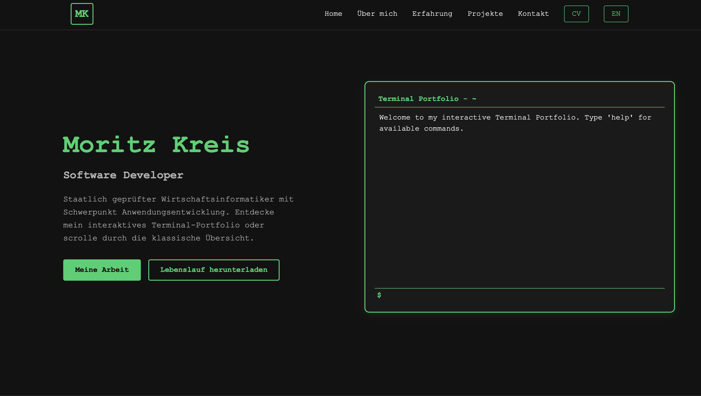

# Portfolio

> Willkommen in meinem interaktiven, zweisprachigen Entwicklerportfolio!
>
> Ich bin **Moritz Kreis** und stelle auf dieser Website meine Projekte, Fähigkeiten und meinen bisherigen Werdegang als Softwareentwickler vor. Mein Portfolio verbindet eine klassische Navigation mit einem interaktiven Terminal, über das Besucher die Website erkunden, Informationen abrufen und meinen Lebenslauf herunterladen können.
>
> Entwickelt habe ich das Projekt mit **Blazor WebAssembly und .NET 10**.

🌐 **[Mein Portfolio besuchen](https://moritz-kreis.de)**

---

## ✨ Features

Mein Portfolio bietet folgende Funktionen:

- Responsive Portfolio-Ansicht mit den Bereichen Über mich, Erfahrung, Projekte und Kontakt
- Interaktives Terminal mit Unix-ähnlichen Befehlen und Befehlshistorie
- Virtuelles Dateisystem zum Erkunden der Portfolio-Inhalte
- Umschaltung zwischen Deutsch und Englisch
- Download meines Lebenslaufs als deutsche oder englische PDF
- Zufällige Fun Facts über eine externe API
- Automatisches Deployment über GitHub Actions

### Terminal-Befehle

Über das integrierte Terminal können Besucher meine Website mit folgenden Befehlen erkunden:

| Befehl | Beschreibung |
|---|---|
| `help [befehl]` | Verfügbare Befehle oder Details zu einem Befehl anzeigen |
| `cd <bereich>` | Zu `about`, `experience`, `projects`, `contact` oder `home` navigieren |
| `ls` | Bereiche beziehungsweise Dateien im aktuellen Bereich auflisten |
| `cat <datei>` | Inhalt einer virtuellen Datei anzeigen |
| `pwd` | Aktuellen Bereichspfad ausgeben |
| `home` | Zur Startseite zurückkehren |
| `cv` | Meinen Lebenslauf in der aktiven Sprache herunterladen |
| `whoami` | Informationen über mich anzeigen |
| `date` | Aktuelles Datum und aktuelle Uhrzeit anzeigen |
| `funfact` | Zufälligen Fun Fact abrufen |
| `clear` | Terminalausgabe leeren |

---

## 🛠 Tech Stack

Für die Entwicklung meines Portfolios verwende ich folgende Technologien:

| Kategorie | Technologie |
|---|---|
| Framework | Blazor WebAssembly auf .NET 10 |
| Sprache | C# |
| UI | Razor Components, HTML5 und CSS3 |
| Browser-Integration | JavaScript Interop |
| Tests | xUnit und NSubstitute |
| Hosting | GitHub Pages |
| CI/CD | GitHub Actions |

---

## 🏗 Architektur

Ich habe mein Portfolio als vollständig clientseitige **Blazor-WebAssembly-Anwendung** entwickelt.

Die Benutzeroberfläche besteht aus Razor Components. Für die Verwaltung der Navigation, der Spracheinstellungen und des Terminalzustands verwende ich separate Services.

Die Terminalbefehle habe ich über ein gemeinsames Command-Modell umgesetzt. Um die Navigation innerhalb des Terminals zu ermöglichen, verwende ich außerdem ein virtuelles Dateisystem.

Browserfunktionen wie das Herunterladen meines Lebenslaufs binde ich über JavaScript Interop ein.

```text
Razor Components
├── Sections und Navigation
└── Terminal
    ├── CommandService
    ├── Commands
    ├── NavigationService
    ├── LanguageService
    └── VirtualFileSystem
```

---

## 📂 Projektstruktur

```text
Portfolio/
├── Portfolio/
│   ├── Components/              # Navigation, Portfolio-Bereiche und Karten
│   ├── Layout/                  # Gemeinsames Seitenlayout
│   ├── Models/
│   │   └── Commands/            # Implementierungen der Terminalbefehle
│   ├── Pages/                   # Start- und Fehlerseite
│   ├── Services/                # Navigation, Sprache, Terminal und Dateisystem
│   ├── wwwroot/
│   │   ├── css/                 # Globales Styling
│   │   ├── cv/                  # Lebensläufe auf Deutsch und Englisch
│   │   ├── images/              # Icons und Bilddateien
│   │   └── js/                  # JavaScript Interop
│   ├── Portfolio.csproj
│   └── Program.cs
├── Portfolio.Tests/             # Unit-Tests
└── Portfolio.sln
```

---

## 🚀 Installation

### Voraussetzungen

Um mein Portfolio lokal auszuführen, werden folgende Werkzeuge benötigt:

- [.NET 10 SDK](https://dotnet.microsoft.com/download/dotnet/10.0)
- Git

### Repository klonen

```bash
git clone https://github.com/PilliPalli/portfolio.git
cd portfolio
```

### Anwendung starten

```bash
dotnet run --project Portfolio/Portfolio/Portfolio.csproj
```

Anschließend ist die Anwendung standardmäßig unter `http://localhost:5143` erreichbar.

### Build und Tests

```bash
dotnet build Portfolio/Portfolio.sln
dotnet test Portfolio/Portfolio.sln
```

---

## ⚙ Konfiguration

Für den lokalen Start meines Portfolios ist keine zusätzliche Konfiguration notwendig.

Allgemeine Blazor-Einstellungen befinden sich in:

`Portfolio/Portfolio/wwwroot/appsettings.json`

### Deployment

Für das automatische Deployment verwende ich **GitHub Actions**.

Bei einem Push auf den Branch `main` wird mein Deployment-Workflow gestartet. Dieser erstellt die Anwendung mit .NET 10 und veröffentlicht den Inhalt von `dist/wwwroot` auf dem Branch `gh-pages`.

Alternativ kann ich das Deployment über `workflow_dispatch` manuell auslösen.

Meine Website ist anschließend über meine eigene Domain erreichbar:

🌐 **https://moritz-kreis.de**

---

## 📸 Screenshots


